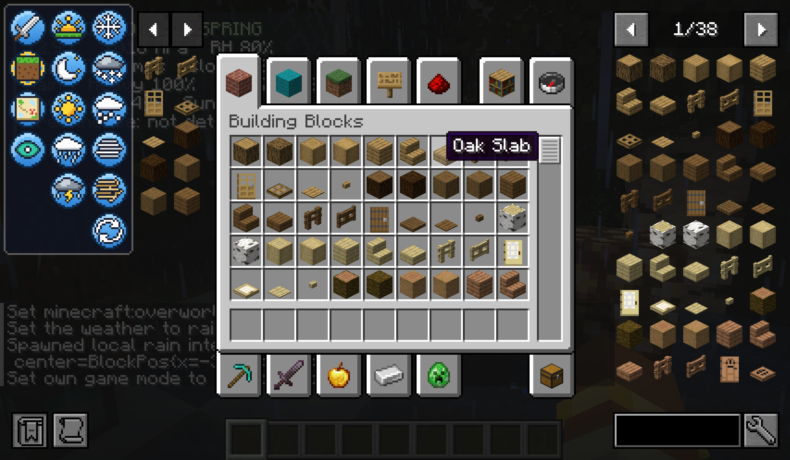

# Inventory Buttons

A client-side NeoForge mod for Minecraft **26.1.2** that adds quick buttons to the survival and creative inventory:

- **Gamemode:** survival, creative, adventure and spectator (the current one has a gold ring)
- **Time:** day and night
- **Weather:** clear, rain and thunderstorm
- **WeatherStory (optional):** snow, snowstorm, hail, fog, sandstorm and "natural weather". Note: WeatherStory is not on Modrinth.
- **[JEI](https://modrinth.com/mod/jei) (optional):** JEI's bookmark and ingredient lists move out of the way of the buttons
- **[GS Mod](https://github.com/steefan1998/GSmod) (optional):** claim the daily reward and open the daily rewards and missions screen



The panel sits in the top-left corner. When there is not enough room next to the inventory (large GUI scale, or the recipe book is open) it switches to a narrower column layout by itself.

## How it works

The buttons send the same packets and commands a player could use: the F3+F4 gamemode packet, `/time set day|night` and `/weather ...`. The server decides whether you are allowed, so the mod also works on servers that do not have it installed. Without cheats or operator rights the buttons are greyed out.

With WeatherStory installed, the weather buttons use its local weather override (`/weatherstory weather spawn <kind> <intensity> <seconds> <radius>`). WeatherStory limits this to at most 600 seconds and a 192 block radius around the player. "Natural weather" (`/weatherstory weather clear`) removes the override and hands the weather back to WeatherStory's climate.

With GS Mod installed, the daily buttons send `/daily claim` and `/daily menu`. Every player may use them, so they are never greyed out; GS Mod's server decides whether a reward is due.

## Languages

English, Nederlands, Deutsch, Français, Español, Italiano, Português (Brasil), Polski, Русский, Українська, Türkçe, Svenska, Čeština, 日本語, 한국어, 简体中文 and 繁體中文. Gamemode names use Minecraft's own translations.

## Settings

In the Mods menu (or `config/inventorybuttons-client.toml`):

| Setting | Default | |
|---|---|---|
| `enabled` | `true` | Show the buttons |
| `offsetX` / `offsetY` | `2` / `2` | Panel position from the top-left corner, in GUI pixels |
| `weatherstory.enabled` | `true` | Use WeatherStory weather when it is installed |
| `weatherstory.intensity` | `100` | Strength of spawned weather, in percent |
| `weatherstory.durationSeconds` | `600` | How long spawned weather lasts (1-600) |
| `weatherstory.radius` | `192` | Radius around the player, in blocks (16-192) |
| `gsmodButtons` | `true` | Show the daily reward and missions buttons when GS Mod is installed |

## Building

Requires Java 25 (Gradle downloads it if needed).

```
./gradlew build
```

The jar ends up in `build/libs/`.

- `./gradlew runDevCheck` starts a separate test client in `run-devcheck/` that loads `run-devcheck/saves/world`, presses the buttons and takes screenshots (`src/devcheck`, not part of the release jar). Put a test world and the WeatherStory/JEI jars in `run-devcheck` first.
- The button and icon sprites are drawn by `tools/IconGen.java`:
  `java tools/IconGen.java src/main/resources/assets/inventorybuttons/textures/gui/sprites`

## License

MIT
